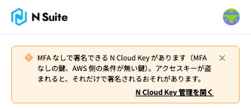
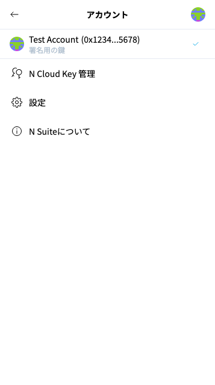
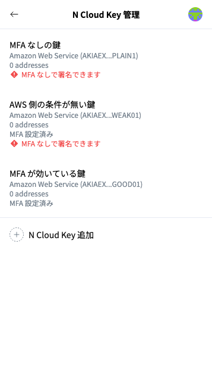
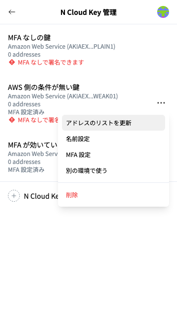
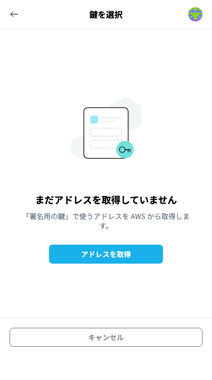

# アドレスのN Walletへの追加方法

## アクセスキー（N Cloud Key）を追加する

**① アカウント一覧を開く**

ホーム画面の右上のアイコンをクリックすると、②のようにアカウント一覧が表示されます。

<figure><figcaption>
ホーム画面の上部（MFA なしで署名できる N Cloud Key があると、このように警告が表示されます）
</figcaption></figure>

**②「N Cloud Key 管理」をクリック**

<figure><figcaption>
アカウント一覧（画像のアドレスは架空の値です）
</figcaption></figure>

**③「N Cloud Key 追加」をクリック**

<figure><figcaption>
「N Cloud Key 管理」
</figcaption></figure>

**④「Amazon Web Services」を選択し、アドレス登録へ進む**


TODO: 今の画面のスクリーンショットに差し替える（「タイプ選択」の画面。今のボタンは「Amazon Web Services」と「ハードウェアウォレット」の2つ）


**⑤ 初期設定と同じ操作で、アドレス登録を完了させる**

AWSの認証情報の入力、MFA の使い方の選択、「鍵を選択」画面での「アドレスを取得」は、初期設定と同じです。詳細は下記に記載しています：


[N Walletの初期設定（AWS KMSのアドレス登録）](register-aws-kms-address-in-n-wallet.md)


## 登録済みの N Cloud Key のアドレスを更新する

AWS KMS に鍵を追加した場合などは、N Cloud Key ごとにアドレスを取得し直します。


以前のアカウント一覧にあった「リストを更新」ボタンは無くなりました。MFA を設定した N Cloud Key ごとにコードが必要なため、アドレスは N Cloud Key ごとに更新します。


**①「N Cloud Key 管理」で、更新する N Cloud Key の右側の「･･･」から「アドレスのリストを更新」を選択**

<figure><figcaption>
N Cloud Key のメニュー
</figcaption></figure>

**②「鍵を選択」画面で「アドレスを取得」をクリック**

その N Cloud Key だけの「鍵を選択」画面が開きます。MFA を設定した N Cloud Key で、コードの入力から時間がたっている場合は、MFA のコードを求められます。認証アプリに表示されている6桁のコードを入力してください。

<figure><figcaption>
「アドレスのリストを更新」で開く「鍵を選択」画面
</figcaption></figure>

**③ 使う鍵を選んで「保存」をクリック**

登録済みの鍵は選ばれた状態で、新しく見つかった鍵は選ばれていない状態で表示されます。追加する鍵を選んで、「保存」をクリックします。「アドレスのリストを更新しました。」と表示されれば完了です。


登録済みの鍵の選択を外して保存すると、そのアドレスは N Wallet のアカウント一覧から外れます（AWS KMS の鍵は削除されません）。

