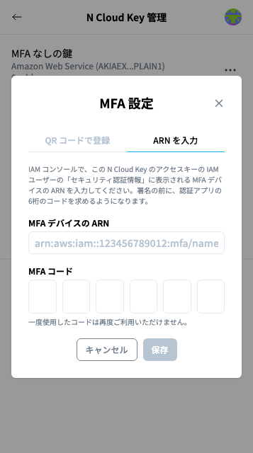

# 複数人で N Wallet を使う場合


本手順の対象者：\
IAMユーザーとアクセスキーを発行するAWSの管理者（インフラ担当）\
※ 「同じ IAM ユーザーを共有する場合」の手順5は、署名する人が行います


## おすすめ: 一人ずつ IAM ユーザーを作る

同じアクセスキーを共有せず、署名する人ごとに IAM ユーザーとアクセスキーを作ってください。アクセスキーを渡すときに、その人に[期限付きの MFA 登録用ポリシー](create-iam-user-for-signing.md)を付けます。

* 各自にとって自分の IAM ユーザーへの1台目の MFA デバイスなので、**それぞれが N Wallet の QR コードで自分で登録できます**（MFA 登録用のポリシーは `user/${aws:username}` に限っているので、自分の IAM ユーザーにしか MFA デバイスを有効化できません）。
* 一人が辞めたり、端末が盗まれたりしたときに、その人のアクセスキーだけを止められます。
* 長期のアクセスキーが、複数の PC に置かれません。
* 誰が署名したかが、IAM ユーザー名で分かります。
* KMS の鍵は同じものを使えます（KMS の許可を、グループまたは各 IAM ユーザーに付けます）。

## 同じ IAM ユーザー（同じアクセスキー）を共有する場合

1つの IAM ユーザーには、MFA デバイスを最大8台まで登録できます（"Your AWS account root user and IAM users can register up to eight MFA devices of any type."）。上限に達すると、N Wallet は「この IAM ユーザーに登録できる MFA デバイスの上限に達しています。」と表示します。

ただし、2人目以降の MFA デバイスは、その IAM ユーザーの2台目以降になります。2台目以降は、既存の MFA デバイスで認証しないと有効化できないため、**N Wallet の QR コードでは登録できません**。次の手順で、管理者が登録してください。

1. 管理者: IAM →「ユーザー」→ 対象のユーザー →「セキュリティ認証情報」→「MFA デバイスの割り当て」をクリック
2. 管理者: デバイス名（例: `suzuki-phone`）を付け、「認証アプリケーション」を選ぶ
3. 2人目: 表示された QR コードを自分のスマホの認証アプリで読み取り、表示された連続した2つのコードを管理者に伝える。管理者がそのコードを入力して「MFA を追加」をクリックする
4. 管理者: 追加した MFA デバイスの ARN を2人目に伝える
5. 2人目: N Wallet の「N Cloud Key 管理」→ 鍵のメニュー →「MFA 設定」→「ARN を入力」で、自分の MFA デバイスの ARN とコードを入力して「保存」をクリックする（[MFA 設定](n-wallet-mfa-settings.md)）

<figure><figcaption>
手順5:「MFA 設定」の「ARN を入力」
</figcaption></figure>


QR コードは MFA の秘密情報そのものです。対面で読み取るのが安全です。画面共有で読み取る場合は、録画しないでください。


誰の MFA デバイスで署名したかは、CloudTrail で確認できます。
