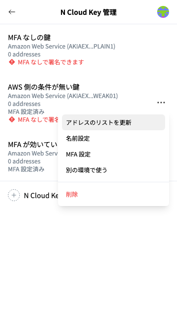
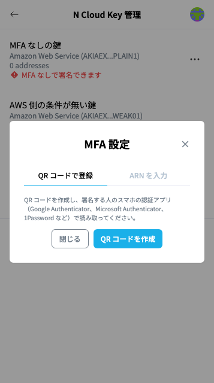
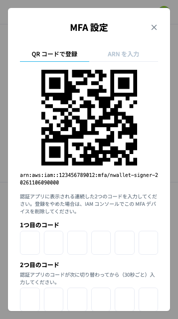
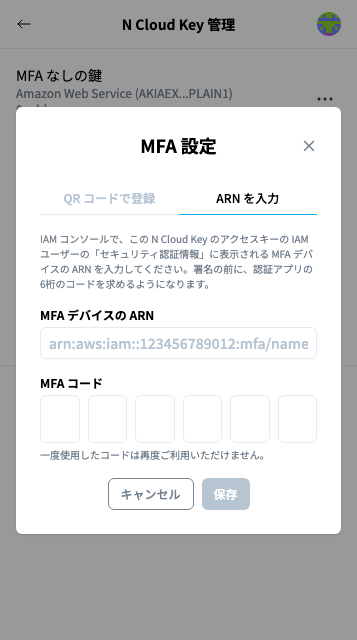
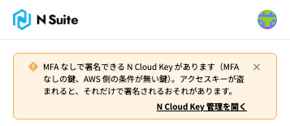
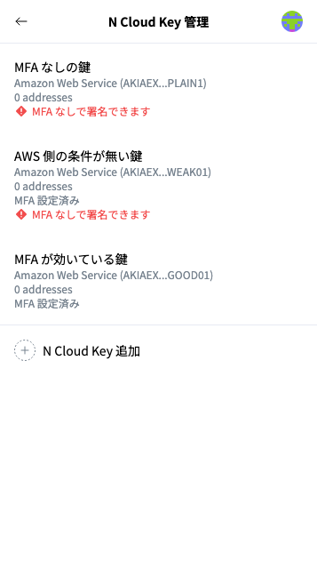

# MFA 設定と「MFA なしで署名できます」の警告


本手順の対象者：\
N Wallet を使う人


MFA を使わずに登録した N Cloud Key にも、後から MFA を設定できます。「N Cloud Key 管理」で、対象の N Cloud Key の右側の「･･･」から「MFA 設定」を選択します。

<figure><figcaption>
N Cloud Key のメニュー
</figcaption></figure>

「MFA 設定」には、「QR コードで登録」と「ARN を入力」の2つのタブがあります。

| その IAM ユーザーの状態 | 使うタブ |
| --- | --- |
| MFA デバイスがまだ無い | QR コードで登録 |
| MFA デバイスがある（ほかの PC・ブラウザで使っている、2人目以降、IAM コンソールで登録済み） | ARN を入力 |

## QR コードで登録する


事前に、インフラ担当がその IAM ユーザーに[期限付きの MFA 登録用ポリシー](create-iam-user-for-signing.md)を付けている必要があります。その期限内に登録してください。


1. 「QR コードで登録」タブで「QR コードを作成」をクリックします
2. 表示された QR コードを、**自分のスマホの認証アプリ**（Google Authenticator、Microsoft Authenticator、1Password など）で読み取ります
3. 認証アプリに表示される**連続した2つのコード**を入力し、「登録」をクリックします。2つ目は、認証アプリのコードが次に切り替わってから（30秒ごと）入力してください

MFA デバイスの ARN は自動で保存されます。「MFA デバイスを登録しました。次の署名から、認証アプリのコードを求めます。」と表示されれば完了です。

<figure><figcaption>
「QR コードで登録」タブ
</figcaption></figure>

<figure><figcaption>
QR コードを作成したところ（画像の QR コードはダミーです）
</figcaption></figure>


QR コードは MFA の秘密情報そのものです。アクセスキーやパスワードと同じように扱い、ほかの人に見せたり、撮影したりしないでください（N Wallet は QR コードを保存せず、登録の後や画面を閉じたときに破棄します）。



* **N Wallet の QR コードで登録できるのは、その IAM ユーザーの1台目の MFA デバイスだけです。** AWS の仕様で、2台目以降は既存の MFA デバイスで認証しないと有効化できないためです。2台目以降は、インフラ担当に IAM コンソールで登録してもらい、「ARN を入力」で設定してください。
* 「MFA デバイスを登録する権限がありません。」と表示された場合は、MFA 登録用のポリシーが付いていないか、期限が切れています。インフラ担当に付け直してもらい、期限内に登録してください。
* N Wallet が作る MFA デバイスの名前は `nwallet-<IAM ユーザー名>-<UTC の日時>` です。IAM コンソールで、N Wallet が作ったものと分かります。
* QR コードを作成した後、登録せずにやめた場合は、有効化されていない MFA デバイスが AWS に残ります。インフラ担当に、IAM コンソールで削除してもらってください。


## ARN を入力する

1. 「ARN を入力」タブを開きます
2. 「MFA デバイスの ARN」に、ARN（`arn:aws:iam::…:mfa/…`）を入力します。ARN は、IAM コンソールのユーザーの「セキュリティ認証情報」で確認できます（分からない場合は、インフラ担当に確認してください）
3. 「MFA コード」に、認証アプリに表示されている6桁のコードを入力し、「保存」をクリックします

<figure><figcaption>
「ARN を入力」タブ（画像の ARN は例の値です）
</figcaption></figure>

MFA を設定した N Cloud Key は、「N Cloud Key 管理」の一覧に「MFA 設定済み」と表示されます。

## 「MFA なしで署名できます」の警告

MFA なしで署名できる N Cloud Key があると、N Wallet は次の2か所に警告を表示します。

* **ホーム画面の上部**: 「MFA なしで署名できる N Cloud Key があります（N Cloud Key の名前）。」と「N Cloud Key 管理を開く」
* **「N Cloud Key 管理」の N Cloud Key の行**: 「MFA なしで署名できます」

<figure><figcaption>
ホーム画面の上部の警告
</figcaption></figure>

<figure><figcaption>
「N Cloud Key 管理」の一覧（画像の N Cloud Key の名前は撮影用です）
</figcaption></figure>

警告が出る理由と対応は、次の2つです。

| 「N Cloud Key 管理」の表示 | 理由 | 対応 |
| --- | --- | --- |
| 「MFA 設定済み」が無い | MFA を設定していません | 鍵のメニューの「MFA 設定」で MFA を設定してください（このページの手順） |
| 「MFA 設定済み」がある | N Wallet では MFA を設定していますが、AWS の設定で MFA なしでも署名できる状態です | インフラ担当に、KMS の許可へ MFA の条件を付けてもらってください（[IAMポリシーの作成](create-iam-policy-for-signing.md)の手順9） |


N Wallet は、ホーム画面や「N Cloud Key 管理」を開いたときなどに、MFA なしでの署名が AWS に拒否されるかを確かめています（実際には署名しません）。インフラ担当が AWS の設定を直した後は、ブラウザを開き直すと、確かめ直した結果が表示されます。

