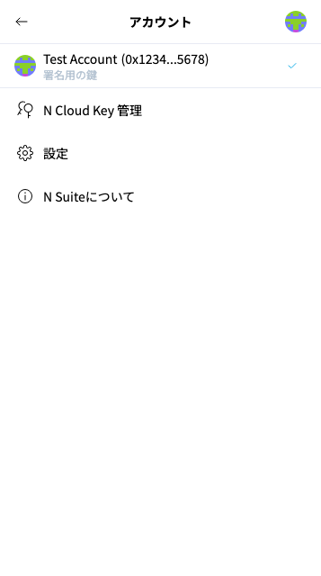
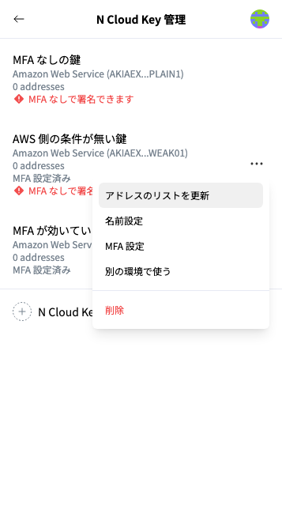

# アドレスとN Cloud Keyへの名前登録

**① アドレスへの名前登録**


TODO: 今の画面のスクリーンショットに差し替える（アカウント一覧でアドレスの「･･･」から「名前設定」を開いた画面。今のアカウント一覧には「リストを更新」ボタンが無い）


アカウント一覧では、"Main Wallet" "Sub Wallet"という風にアドレスに名前を付けることができます。アドレスの右側に表示されている「･･･」から「名前設定」を選択し、任意の名前を入力ください。

**② N Cloud Keyへの名前登録**

<figure><figcaption>
アカウント一覧（画像のアドレスは架空の値です）
</figcaption></figure>

既存のN Cloud Keyに名前を登録することができます。N Cloud Keyにアクセスするには、右上のアイコンよりアドレス一覧を開き、下の方にある「N Cloud Key 管理」を開きます。

<figure><figcaption>
N Cloud Key のメニュー
</figcaption></figure>

N Cloud Key の一覧が表示されますので、名前を登録したいN Cloud Keyの右側にある「･･･」から「名前設定」を選択し、任意の名前を入力ください。保存後は、「N Cloud Key 管理」の一覧に、付けた名前が表示されます。
