# N Walletの初期設定（AWS KMSのアドレス登録）


AWS KMSで秘密鍵を管理している場合、本手順でN Walletにアドレスを登録してください。



本手順を行う前に、AWSで秘密鍵の作成を行うご担当者（インフラ担当）から、AWSの認証情報（`Access Key ID` と`Secret Access Key` ）を受け取ってください。詳細は秘密鍵の管理者向け手順を確認してください。

MFA を使う場合は、あわせて次のどちらかが必要です。

* MFA デバイスを新しく登録する場合: インフラ担当が、その IAM ユーザーに[期限付きの MFA 登録用ポリシー](attach-mfa-registration-policy.md)を付けていること。**その期限内に**本手順を行ってください（アクセスキーを受け取るときに、インフラ担当と時間を合わせてください）
* すでに MFA デバイスがある場合: その MFA デバイスの ARN（インフラ担当に確認してください）



ほかの PC・ブラウザで使っている N Wallet から移す場合は、[別の PC・ブラウザで使う](use-on-another-pc.md)の手順で登録してください。


## ① 秘密鍵管理サービスで「Amazon Web Service」を選択

<figure>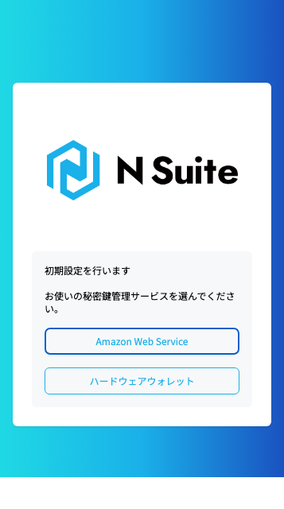<figcaption>
秘密鍵管理サービスの選択
</figcaption></figure>

## ② AWSの認証情報を入力し、MFA の使い方を選んで「登録」をクリック

AWSの認証情報（`Access Key ID` と `Secret Access Key`）を入力します。「名前」は任意です（入力しない場合は「N Cloud Key 1」のような名前になります）。

続けて「MFA」で、MFA の使い方を3つから選びます。**MFA を使うことをおすすめします**（最初は「新しく登録する（QR コード）」が選ばれています）。

| その IAM ユーザーの状態 | 選ぶもの | 次の手順 |
| --- | --- | --- |
| MFA デバイスがまだ無い | 新しく登録する（QR コード） | ③-A |
| MFA デバイスがある（ほかの PC・ブラウザで使っている、2人目以降、IAM コンソールで登録済み） | ほかの PC・ブラウザで使っている（ARN を入力） | ③-B |
| MFA を使わない | MFA を使わない | ④ |

<figure>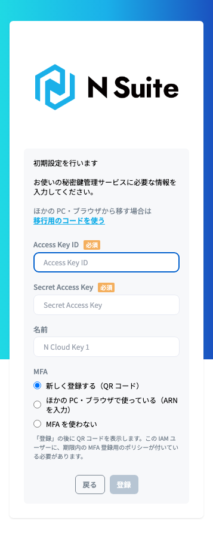<figcaption>
「新しく登録する（QR コード）」を選んだとき
</figcaption></figure>

<figure>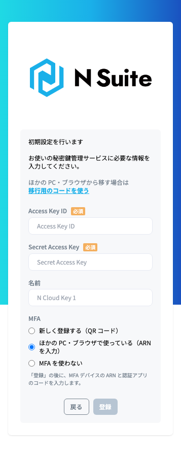<figcaption>
「ほかの PC・ブラウザで使っている（ARN を入力）」を選んだとき
</figcaption></figure>


「MFA を使わない」を選ぶと、アクセスキーが盗まれたときに、それだけで署名されるおそれがあります。また、AWS のポリシーで KMS の利用に MFA を必須にしている場合は登録できません。


<figure>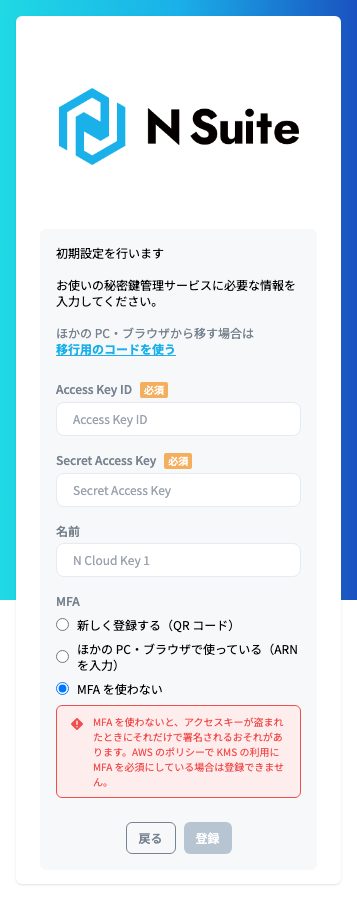<figcaption>
「MFA を使わない」を選んだとき
</figcaption></figure>

## ③-A QR コードで MFA デバイスを登録する（「新しく登録する（QR コード）」を選んだ場合）

1. 「登録」の後に表示される QR コードを、**自分のスマホの認証アプリ**（Google Authenticator、Microsoft Authenticator、1Password など）で読み取ります
2. 認証アプリに表示されているコードを「1つ目のコード」に入力します。6桁を入力すると、「2つ目のコード」に移ります
3. 認証アプリのコードが次に切り替わるのを待って（30秒ごと）、新しいコードを「2つ目のコード」に入力し、「登録」をクリックします

MFA デバイスの ARN は自動で保存され、④の「鍵を選択」画面に移ります。

<figure>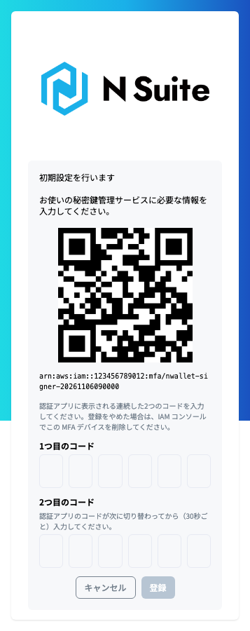<figcaption>
QR コードの画面（画像の QR コードはダミーです）
</figcaption></figure>

<figure><figcaption>
1つ目のコードを入力すると、2つ目に移る
</figcaption></figure>

2つ目に1つ目と同じコードを入力すると、「2つ目には、1つ目の次に表示されたコードを入力してください。」と表示されます。コードが切り替わるのを待って、新しいコードを入力してください。

<figure>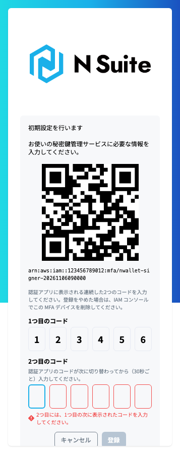<figcaption>
同じコードを2回入力したとき
</figcaption></figure>


QR コードは MFA の秘密情報そのものです。アクセスキーやパスワードと同じように扱い、ほかの人に見せたり、撮影したりしないでください（N Wallet は QR コードを保存しません）。



* 「MFA デバイスを登録する権限がありません。」と表示された場合は、MFA 登録用のポリシーが付いていないか、期限が切れています。インフラ担当に付け直してもらい、期限内に登録してください。
* QR コードで登録できるのは、その IAM ユーザーの1台目の MFA デバイスだけです。すでに MFA デバイスがある場合は、「ほかの PC・ブラウザで使っている（ARN を入力）」を選んでください。
* QR コードを表示した後、登録せずにやめた場合は、有効化されていない MFA デバイスが AWS に残ります。インフラ担当に、IAM コンソールで削除してもらってください。


## ③-B MFA デバイスの ARN を入力する（「ほかの PC・ブラウザで使っている（ARN を入力）」を選んだ場合）

「MFA デバイスの ARN」に、ARN（`arn:aws:iam::…:mfa/…`）を入力して「登録」をクリックします。ARN は、インフラ担当に確認してください（IAM コンソールのユーザーの「セキュリティ認証情報」で確認できます）。

認証アプリのコードは、この後の④で入力します。

<figure>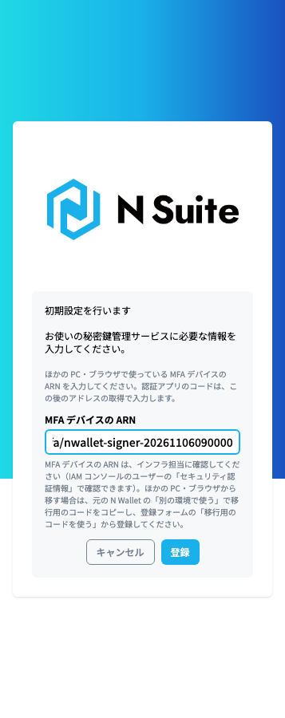<figcaption>
MFA デバイスの ARN を入力する画面
</figcaption></figure>

## ④「鍵を選択」画面で「アドレスを取得」をクリック

「鍵を選択」画面が開きます。まだアドレスが無いので、中央の「アドレスを取得」をクリックします。

<figure>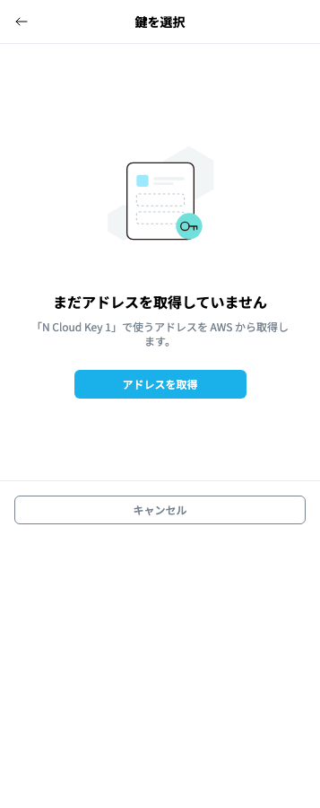<figcaption>
登録直後の「鍵を選択」画面
</figcaption></figure>

MFA を設定した場合は、MFA のコードを求められます。認証アプリに表示されている6桁のコードを入力し、「アドレスを取得」をクリックします。

<figure>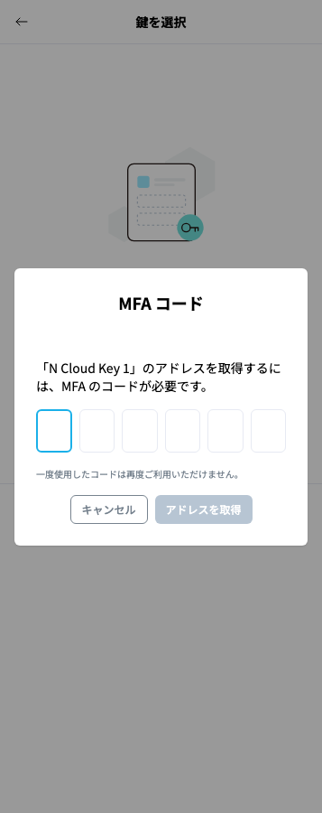<figcaption>
アドレスの取得で MFA のコードを求められる
</figcaption></figure>


③-A で QR コードから登録した場合は、登録に使ったコードは使えません（一度使ったコードは、AWS が再度の利用を認めません）。**認証アプリのコードが次に切り替わってから**、新しいコードを入力してください。


<figure>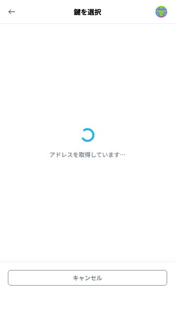<figcaption>
アドレスを取得している間
</figcaption></figure>

## ⑤ 使う鍵を選んで「登録」をクリック

AWS KMS の鍵が一覧で表示されます（鍵の名前、アドレス、リージョン）。最初はすべての鍵が選ばれています。N Wallet で使わない鍵があれば選択を外し、「登録」をクリックします。

<figure>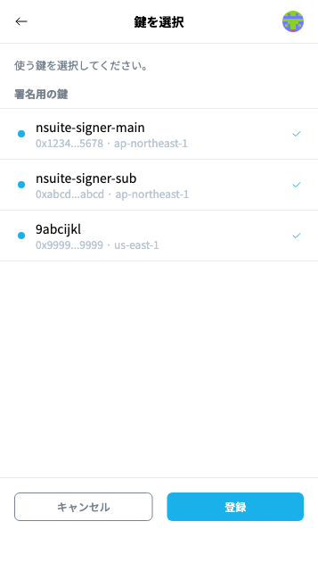<figcaption>
アドレスを取得した後の「鍵を選択」画面（画像のアドレスは架空の値です）
</figcaption></figure>

以上で初期設定は完了です。MFA を設定した N Cloud Key では、次の署名から認証アプリのコードを求められます（[MFA を設定した N Cloud Key で署名する](sign-with-mfa.md)）。


「アドレスを取得」をクリックする前に画面を閉じても、次に N Wallet を開いたときに「鍵を選択」画面から再開できます。QR コードでの登録では、MFA デバイスの登録が AWS で済んだ時点で N Cloud Key が保存されるので、その後に画面を閉じても同じように再開できます。


## うまくいかないとき

**「アドレスが見つかりませんでした」と表示される**

そのアクセスキーで使える AWS KMS の鍵がありません。インフラ担当に、AWS の鍵と権限を確認してもらい、「アドレスを取得」をクリックし直してください。

<figure>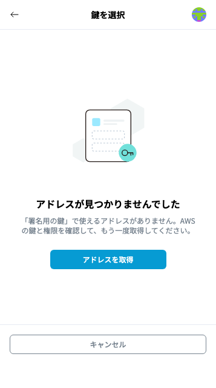<figcaption>
使えるアドレスが無いとき
</figcaption></figure>

**「アドレスを取得できませんでした」と表示される**

アクセスキーと通信状況を確認して、「アドレスを取得」をクリックし直してください。AWS のポリシーで KMS の利用に MFA を必須にしている場合は、MFA を設定してから取得し直してください（[MFA 設定](n-wallet-mfa-settings.md)）。

<figure>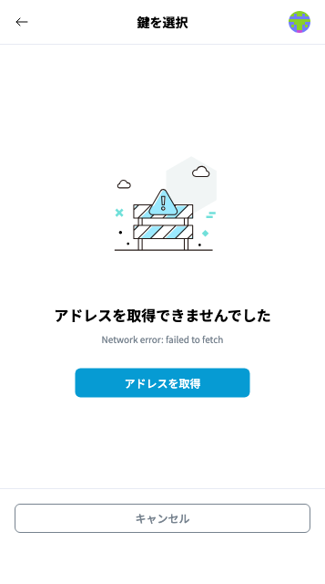<figcaption>
取得に失敗したとき
</figcaption></figure>

**「MFA のコードを入力しましたが、AWS にアドレスの取得を拒否されました。」と表示される**

インフラ担当に、KMS の許可（`aws:MultiFactorAuthAge` など）を確認してもらってください（[KMS の署名に MFA を必須にする](require-mfa-for-kms-signing.md)）。
