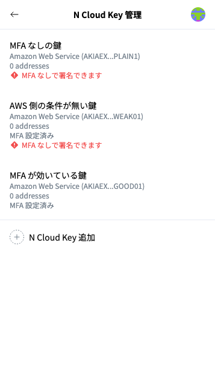

# KMS の署名に MFA を必須にする


本手順の対象者：\
IAMポリシー・KMSの鍵ポリシーを管理するAWSの管理者（インフラ担当）


N Wallet の N Cloud Key に MFA を設定するだけでは、AWS 側は MFA なしの署名も受け付けたままです。KMS の許可に MFA の条件を付けると、**アクセスキーが単体で漏れても、それだけでは署名できなくなります**。


このページは、N Wallet を新しく導入する場合の手順です。すでに MFA を使わずに N Wallet で署名している場合は、このページの最後の「MFA を使わずに運用している環境に導入する場合」の順番で進めてください。


## 設定の流れ

1. **IAM ポリシーを作るときに、MFA の条件を付ける**。[IAMポリシーの作成](create-iam-policy-for-signing.md)で作る、KMS の署名を許可するポリシーに、下記「MFA の条件」を付けます
2. **IAM ユーザーとアクセスキーを作る**（[IAMユーザーの作成](create-iam-user-for-signing.md)）
3. **アクセスキーを渡すときに、[期限付きの MFA 登録用ポリシー](attach-mfa-registration-policy.md)を付ける**
4. **署名する人が、その期限内に N Wallet の初期設定を行う**。MFA は「新しく登録する（QR コード）」を選び、QR コードで MFA デバイスを登録してから、アドレスを取得します（[N Walletの初期設定（AWS KMSのアドレス登録）](register-aws-kms-address-in-n-wallet.md)）
5. **MFA が効いていることを確認する**。署名する人の N Wallet の「N Cloud Key 管理」に「MFA 設定済み」と表示され、「MFA なしで署名できます」の警告が出ていないことを確かめます。N Wallet は判定できなかった場合も警告を出さないため、下記「MFA なしで署名できる経路の確認」もあわせて行ってください


* 1で KMS の許可に MFA の条件を付けていても、署名する人は N Wallet で MFA デバイスを登録し、アドレスを取得できます（QR コードで登録する場合は、3の MFA 登録用ポリシーの期限内に限ります）。
* 署名する人が N Wallet で「MFA を使わない」を選ぶと、アドレスを取得できません。MFA の条件が付いているためで、想定どおりの動きです。
* すでに MFA デバイスがある IAM ユーザー（2人目以降など）は、3の代わりに MFA デバイスの ARN を署名する人に伝えます。署名する人は、初期設定で「ほかの PC・ブラウザで使っている（ARN を入力）」を選びます。詳しくは[複数人で N Wallet を使う場合](multiple-signers.md)を参照してください。


## MFA の条件

KMS の署名を許可するステートメントに、次の `Condition` を付けます。

```json
"Condition": {
  "Bool": { "aws:MultiFactorAuthPresent": "true" },
  "NumericLessThanEquals": { "aws:MultiFactorAuthAge": "3600" }
}
```

AWS コンソールでは、IAM →「ポリシー」で対象のポリシーを開き、「編集」で「JSON」に切り替えて、`"Effect": "Allow"` のステートメントに上の `Condition` を追加します（すでに `Condition` がある場合は、その中に `Bool` と `NumericLessThanEquals` を足します）。

### 注意


**`aws:MultiFactorAuthAge` は 3600 以上にしてください**

* N Wallet は、MFA のコードを使って、1時間（3600秒）有効な一時認証情報を取得します。
* 3600 より短くすると、上限を過ぎた時点で署名が AWS に拒否されます。
* 拒否されると、N Wallet はその一時認証情報を消し、次の署名でコードを求めます。ただし、その時点の署名は失敗するため、署名する人はサイトから署名をやり直す必要があります（N Wallet には「MFA の一時認証情報が AWS に拒否されました（有効時間の上限など）。」と表示されます）。


* **MFA を強制する Deny ポリシーを使う場合は、`sts:GetSessionToken` を除外してください**（`NotAction` に含めます）。除外しないと、N Wallet が一時認証情報を取得できません。
* `sts:GetSessionToken` 自体には、権限の付与は必要ありません（"No permissions are required for users to perform this operation"）。

## MFA なしで署名できる経路の確認

MFA の条件を付けても、ほかの場所で署名を許可していると、MFA なしで署名できてしまいます。次を確認してください。

* そのユーザーに付いている、ほかのポリシー
* そのユーザーが所属するグループのポリシー
* **KMS の鍵ポリシーで、そのユーザーを直接許可していないか**

### N Wallet の警告で確かめる

N Wallet は、MFA なしで署名できる N Cloud Key があると、ホーム画面の上部と「N Cloud Key 管理」に「MFA なしで署名できます」と警告を出します（[MFA 設定と「MFA なしで署名できます」の警告](n-wallet-mfa-settings.md)）。

<figure><figcaption><p>「N Cloud Key 管理」の一覧。上の2つは「MFA なしで署名できます」の警告が出ている</p></figcaption></figure>

| N Cloud Key の状態 | 判定 |
| --- | --- |
| MFA を設定していない | 必ず警告します（N Wallet がアクセスキーだけで署名するため。AWS には問い合わせません） |
| MFA を設定している | アクセスキーだけ（MFA なし）で `kms:Sign` を **DryRun** で呼び、「成功するはずだった」なら警告します。拒否（`AccessDeniedException`）なら、MFA が効いています。判定できなかった場合は警告しません |

* DryRun では、実際には署名しません。判定には、IAM のポリシー・KMS の鍵ポリシー・SCP がすべて含まれます。
* 判定するのは、ホーム画面・「N Cloud Key 管理」を開いたときと、N Cloud Key のアドレスを登録した直後です。判定の結果はブラウザを閉じるまで覚えておき、MFA デバイスの ARN を設定し直したときは判定し直します。
* 1つの N Cloud Key で判定する KMS の鍵は、その N Cloud Key で使う鍵の1つ目だけです（MFA の条件は、ふつう IAM のポリシーにまとめて書くため、1つで代表させています）。KMS の鍵ポリシーで鍵ごとに許可を変えている場合は、ほかの鍵も上の確認項目で確かめてください。


**CloudTrail で KMS の AccessDenied を監視している場合**

MFA が効いていると、この判定は CloudTrail に `kms:Sign` の `AccessDenied` として記録されます。拒否された記録には DryRun の印が残らないため、通常の署名の失敗と見分けられません。署名する人が「N Cloud Key 管理」を開いたときや、N Cloud Key を登録した直後に、署名用の IAM ユーザーから1件ずつ記録されることを、監視の担当者に伝えておいてください。成功する場合は、`Sign`（DryRun）として記録されます。


## MFA を使わずに運用している環境に導入する場合

すでに MFA を使わずに N Wallet で署名している場合は、**必ず次の順番で**進めてください。

1. **N Wallet を MFA 対応版に更新する**（[N Walletの手動アップデート](update-n-wallet.md)）
2. **IAM ユーザーに MFA デバイスを登録する**。方法は次のどちらかです
   * N Wallet の QR コードで登録する。インフラ担当が[期限付きの MFA 登録用ポリシー](attach-mfa-registration-policy.md)を付け、署名する人がその期限内に[MFA 設定](n-wallet-mfa-settings.md)の「QR コードで登録」で登録します
   * IAM コンソールで登録し、署名する人が N Wallet の「N Cloud Key 管理」→ 鍵のメニュー →「MFA 設定」→「ARN を入力」で ARN を設定する。ARN は、IAM コンソールのユーザーの「セキュリティ認証情報」で確認できます
3. **各 N Cloud Key に MFA が設定されたことを確認する**。N Wallet の「N Cloud Key 管理」の一覧に「MFA 設定済み」と表示されます
4. **IAM ポリシーを締める**。KMS の許可に、上記「MFA の条件」を付けます
5. **MFA なしで署名できる経路が残っていないか確認する**（上記「MFA なしで署名できる経路の確認」）


4を先に行うと、MFA を設定していない N Wallet では、署名もアドレスの取得もできなくなります。

