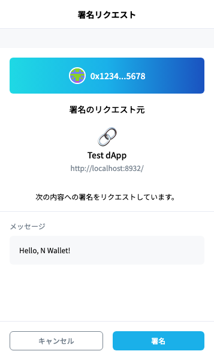
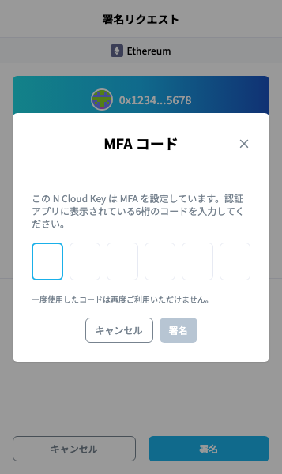
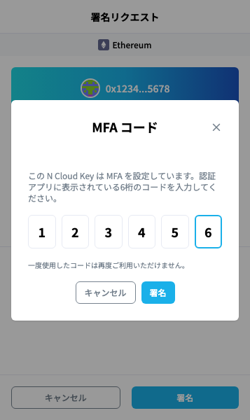
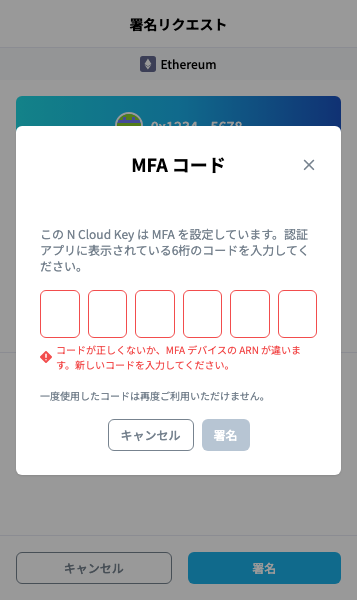

# MFA を設定した N Cloud Key で署名する


本手順の対象者：\
N Wallet を使う人


MFA を設定した N Cloud Key では、署名の前に、スマホの認証アプリに表示される6桁のコードを入力します。

## 署名の手順

**① 署名の確認画面で内容を確認し、「署名」をクリック**

<figure><figcaption>
署名の確認画面
</figcaption></figure>

**②「MFA コード」に、認証アプリに表示されている6桁のコードを入力し、「署名」をクリック**

<figure><figcaption>
「署名」の後に表示される MFA のコードの入力
</figcaption></figure>

<figure><figcaption>
6桁を入力したところ
</figcaption></figure>

コードが正しくない場合は、「コードが正しくないか、MFA デバイスの ARN が違います。新しいコードを入力してください。」と表示されます。その場で、認証アプリの新しいコードを入力し直してください。

<figure><figcaption>
コードが正しくないとき
</figcaption></figure>


「MFA コード」の「キャンセル」をクリックすると、署名の確認画面に戻ります。署名のリクエストを拒否したことにはなりません。


## コードを求められるタイミング

* 正しいコードを入力すると、その後およそ1時間は、コードなしで署名できます。
* 1時間の期限の少し前（10分前）から、再びコードを求めます。作業中でも、1時間ごとに入力が必要です。
* ブラウザを閉じると、次の署名でコードを求めます（N Wallet は、コードで取得した一時的な認証情報をディスクに保存しません）。
* 一度使ったコードは、再び使えません。続けてコードを求められた場合は、認証アプリのコードが次に切り替わるのを待って入力してください。

## うまくいかないとき

**「MFA の一時認証情報が AWS に拒否されました（有効時間の上限など）。」と表示される**

サイトから署名をやり直し、新しいコードを入力してください。何度も表示される場合は、インフラ担当に KMS の許可の `aws:MultiFactorAuthAge` を確認してもらってください（3600 以上が必要です。[IAMポリシーの作成](create-iam-policy-for-signing.md)の手順9）。

**「MFA のコードの確認が済んでいません。」と表示される**

サイトから署名をやり直し、確認画面でコードを入力してください。

**「AWSのアクセスキーに署名権限がありません。」と表示される**

AWS のポリシーで KMS の利用に MFA を必須にしている場合は、「N Cloud Key 管理」の「MFA 設定」で MFA を設定してください（[MFA 設定と「MFA なしで署名できます」の警告](n-wallet-mfa-settings.md)）。MFA を設定済みの場合は、インフラ担当に権限設定の確認を依頼してください。
