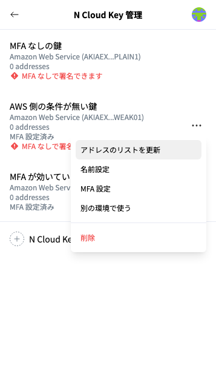
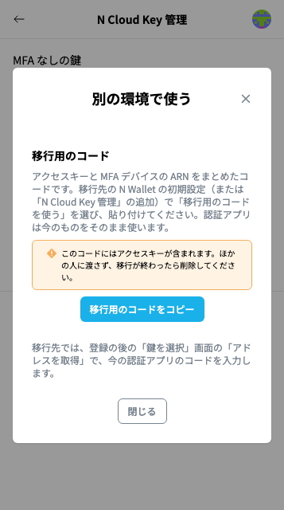
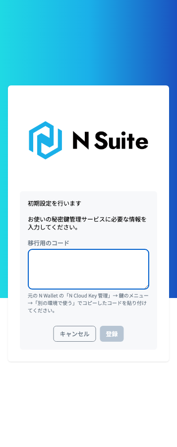
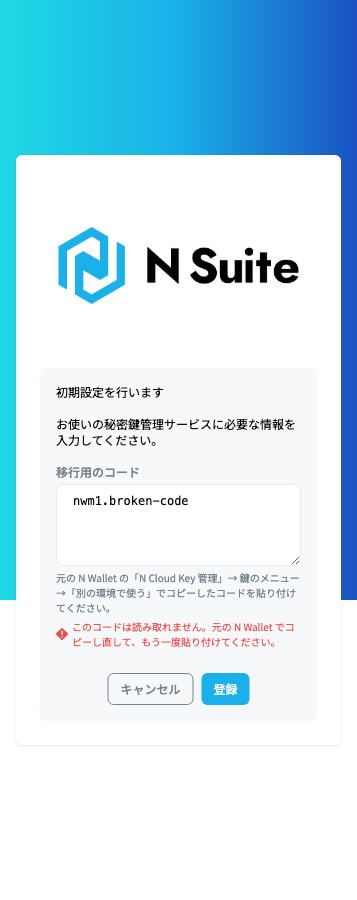

# 別の PC・ブラウザで使う


本手順の対象者：\
N Wallet で署名する人（「新しいアクセスキーを受け取る」方法では、インフラ担当も関わります）


KMS の利用に MFA を必須にした N Cloud Key は、**アクセスキーだけでは別の PC・ブラウザで登録できません**（QR コードで登録できるのは、その IAM ユーザーの1台目の MFA デバイスだけで、MFA 登録用のポリシーにも期限があるためです）。次のどちらかの方法で登録してください。

どちらの方法でも、**認証アプリは今のもの（同じスマホ）をそのまま使います**。移行先の「鍵を選択」画面の「アドレスを取得」で、そのコードを入力します。

| 方法 | 移すもの | 移行先での操作 |
| --- | --- | --- |
| **移行用のコードを使う**（元の N Wallet から移す） | アクセスキー・シークレットアクセスキー・MFA デバイスの ARN（と N Cloud Key の名前）をまとめた1行のコード | 初期設定（または「N Cloud Key 管理」の追加）で「移行用のコードを使う」を選び、コードを貼り付けて「登録」 |
| **インフラ担当から新しいアクセスキーを受け取る** | 何も移しません。MFA デバイスの ARN は、インフラ担当に確認します（同じ IAM ユーザーなら、MFA デバイスも同じです） | 受け取ったアクセスキーを入力し、MFA で「ほかの PC・ブラウザで使っている（ARN を入力）」を選んで ARN を入力 |


環境ごとにアクセスキーを分けたい場合は、インフラ担当に新しいアクセスキーを発行してもらってください（上の表の2つ目の方法）。移行用のコードを使うと、同じアクセスキーが複数の環境に広がるため、1台をなくしてアクセスキーを無効にすると、ほかの環境でも使えなくなります。


## 移行用のコードを使う

**① 元の N Wallet で、移行用のコードをコピーする**

「N Cloud Key 管理」で、移す N Cloud Key の右側の「･･･」から「別の環境で使う」を選択し、「移行用のコードをコピー」をクリックします。

<figure><figcaption>
N Cloud Key のメニュー
</figcaption></figure>

<figure><figcaption>
「別の環境で使う」
</figcaption></figure>

**② 移行先の N Wallet で、「移行用のコードを使う」をクリックする**

移行先の N Wallet の初期設定（または「N Cloud Key 管理」の「N Cloud Key 追加」）で、AWS の認証情報の入力画面を開き、上部の「移行用のコードを使う」をクリックします（[N Walletの初期設定（AWS KMSのアドレス登録）](register-aws-kms-address-in-n-wallet.md)の②の画面です）。

**③ コピーしたコードを「移行用のコード」に貼り付けて、「登録」をクリックする**

<figure><figcaption>
「移行用のコード」の入力
</figcaption></figure>

コードの一部が欠けているなど、読み取れない場合は「このコードは読み取れません。」と表示されます。元の N Wallet でコピーし直して、もう一度貼り付けてください。

<figure><figcaption>
読み取れないコードを貼り付けたとき
</figcaption></figure>

**④「鍵を選択」画面で「アドレスを取得」をクリックし、今の認証アプリのコードを入力する**

この後は、初期設定の④・⑤と同じです（[N Walletの初期設定（AWS KMSのアドレス登録）](register-aws-kms-address-in-n-wallet.md)）。

**⑤ 移行が終わったら、コピーしたコードを削除する**

コードを貼り付けたメモやチャットなどから、コードを削除してください。

## 移行用のコードの扱い

移行用のコードにはアクセスキーが含まれます。ほかの人に渡さず、移行が終わったら削除してください。コードが漏れた、またはコードを残した PC をなくした場合は、すぐにインフラ担当に連絡し、アクセスキーを作り直してもらってください。


移行用のコードは暗号化ではないため、コードからアクセスキーを取り出せます。



コードを作れるのは、MFA が効いていると N Wallet が確かめた N Cloud Key だけです。ただし、漏れたコードで署名されないのは、インフラ担当がそのアクセスキーで使えるすべての KMS の鍵に MFA の条件を付けている場合に限ります。

